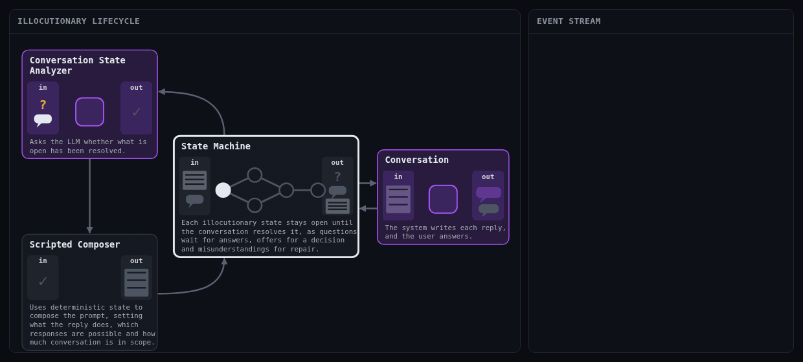
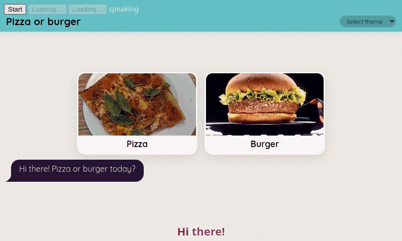
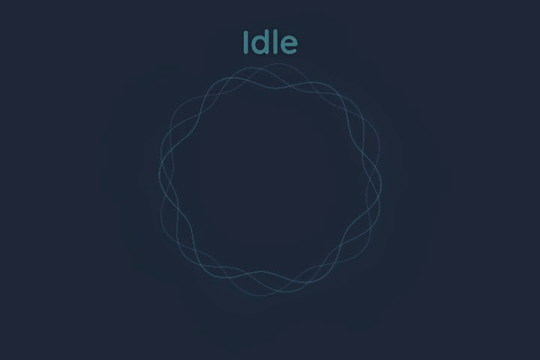
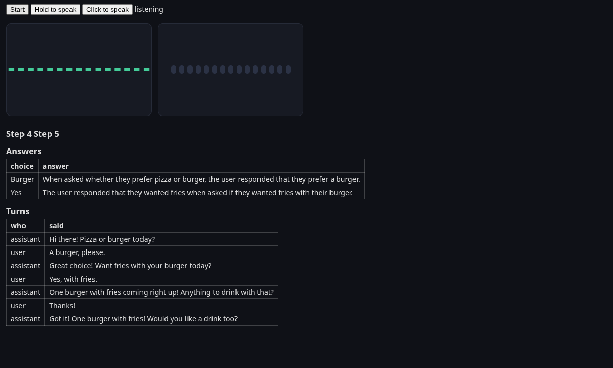
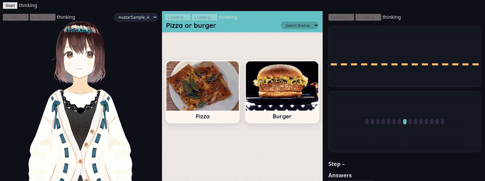
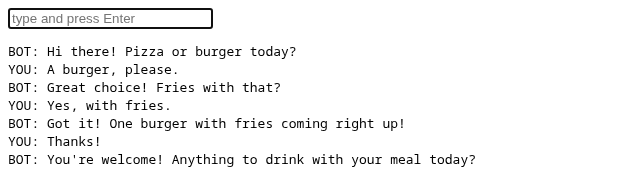

<h1 align="center">Illocutionary Lifecycles</h1>

<p align="center"><strong>A library for running conversations with a language model.</strong></p>

<p align="center">
  
  
  
  
  
  <a href="LICENSE"></a>
</p>

<p align="center">
  <a href="#install">Install</a> ·
  <a href="#example-frontends-built-over-il">Example frontends built over IL</a> ·
  <a href="#run-a-conversation">Run it</a> ·
  <a href="#a-custom-server">Custom server</a> ·
  <a href="#the-package">The package</a>
</p>

<p align="center">
  
</p>

IL runs a dialogue as a set of states, defined in `flow.json`, which keeps each state's prompt separate from the information that state requires. The library holds both outside the language model, checks after every user utterance what has been established, and uses the result to select the next state. The language model generates each reply from a prompt composed for that turn, and does not decide what has been established.

The name comes from speech act theory, where the illocutionary force of an utterance is what the utterance does, such as asking or answering *(as described by J. L. Austin in How to Do Things with Words, 1962)*.

## Example frontends built over IL

IL runs the conversation and ships no frontend. Any client, a browser, a native app or a robot, drives it over the text WebSocket, the press-to-speak WebSocket or WebRTC voice, and a browser client connects through `ConnectConversation.js`. The examples use common open-source UI libraries, unchanged, all on the same Pizza-or-burger conversation.

- **[Visual kiosk](examples/1-chatbot-visual-kiosk)**, picture cards for each choice and chat bubbles, styled with [daisyUI](https://daisyui.com).
- **[Press to speak](examples/2-press-to-speak)**, a hold-to-talk button with [LiveKit's audio visualizer](https://github.com/livekit/components-js) and live tables of the step, the answers and the turns.
- **[VRM character](examples/3-vrm-press-to-speak)**, a 3D avatar with lip sync, blinks and nods, on [three.js](https://threejs.org) and [@pixiv/three-vrm](https://github.com/pixiv/three-vrm). Also [over Pipecat](examples/5-vrm-pipecat).
- **[Rive character](examples/4-rive-press-to-speak)**, a 2D animated character with lip sync, on the [Rive web runtime](https://github.com/rive-app/rive-wasm). Also [over Pipecat](examples/6-rive-pipecat).
- **[Plasma visualizer](examples/7-plasma-visualizer-pipecat)**, a plasma animation driven by the assistant's audio, from [Pipecat's voice-ui-kit](https://github.com/pipecat-ai/voice-ui-kit).
- **[Side by side](examples/8-side-by-side)**, any of these frontends together on one conversation.
- **[Text](examples/0-text)**, an example of the pure text API, a WebSocket endpoint any client can connect to.

Each example's README gives the library versions and licences and how to rebuild the bundle.

<table>
  <tr>
    <td></td>
  </tr>
  <tr>
    <td align="center"><sub><a href="examples/1-chatbot-visual-kiosk"><code>1-chatbot-visual-kiosk</code></a>, the current step's choices as picture cards, with real model and speech, sped up by a quarter.</sub></td>
  </tr>
</table>

<table>
  <tr>
    <td width="50%"></td>
    <td width="50%"></td>
  </tr>
  <tr>
    <td align="center"><sub><a href="examples/7-plasma-visualizer-pipecat"><code>7-plasma-visualizer-pipecat</code></a>. Pipecat's Plasma visualizer changes its state between listening, thinking and speaking on the RTVI events.</sub></td>
    <td align="center"><sub><a href="examples/2-press-to-speak"><code>2-press-to-speak</code></a>, hold a button to speak, with the step, the answers and the turns as tables.</sub></td>
  </tr>
  <tr>
    <td></td>
    <td></td>
  </tr>
  <tr>
    <td align="center"><sub><a href="examples/8-side-by-side"><code>8-side-by-side</code></a> joins frontends over one conversation, here the VRM character, the picture cards and the audio bars, with real model and speech.</sub></td>
    <td align="center"><sub><a href="examples/0-text"><code>0-text</code></a>, an example of the pure text API, a WebSocket endpoint any client can connect to.</sub></td>
  </tr>
</table>

## Install

Clone the repository and install it with the extra for the transport, text over WebSocket, press-to-speak over WebSocket, or voice over WebRTC through Pipecat.

```bash
git clone https://github.com/LeoHuovinen/illocutionary-lifecycles.git
cd illocutionary-lifecycles

pip install -e ".[text]"            # text over WebSocket
pip install -e ".[press]"           # press-to-speak over WebSocket, half-duplex, Azure STT and TTS, no Pipecat
pip install -e ".[pipecat]"         # full-duplex voice over WebRTC through Pipecat
pip install -e ".[text,cosmos]"     # extras combine, here text with Cosmos DB storage
```

| extra | what it adds | for |
|---|---|---|
| `text` | fastapi, uvicorn, websockets | `TextAdapterWebsocketMount`, text over WebSocket, and `HTTPEndpointMount`, an OpenAI-compatible API over HTTP |
| `press` | the `text` extra and azure-cognitiveservices-speech | `PressToSpeakAdapterWebsocketMount`, press-to-speak over the same WebSocket, half-duplex, Azure STT and TTS |
| `pipecat` | pipecat-ai 1.12 or newer and below 2, with silero, azure, runner, webrtc, elevenlabs, openai, and python-dotenv | `PipecatVoiceAdapterWebRtcMount`, full-duplex voice over WebRTC |
| `local` | transformers, torch | a local model instead of a hosted one |
| `cosmos` | azure-cosmos | saving sessions in Azure Cosmos DB; saving them as local files needs no extra |
| `dev` | pytest, pytest-asyncio, pytest-cov, ruff | working on the library itself |

Python 3.11 or newer. Beyond the extras, the only dependency is `openai`.

## Environment variables

Everything comes from the environment, there is no default model, and a missing variable is named in the error at session start. The Pipecat voice example servers load the nearest `.env`, looking in the folder they start from and then in each folder above it, so one `.env` at the top of the repository serves them all. A text or press server reads the shell.

| variable | needed for |
|---|---|
| `OPENAI_API_KEY`, `OPENAI_MODEL`, `OPENAI_BASE_URL` | the model, through any OpenAI-compatible API, all three |
| `AZURE_OPENAI_API_KEY`, `AZURE_OPENAI_ENDPOINT`, `AZURE_OPENAI_DEPLOYMENT`, `AZURE_OPENAI_API_VERSION` | the model, through Azure OpenAI, all four, instead of the row above |
| `AZURE_SPEECH_KEY`, `AZURE_SPEECH_REGION` | press-to-speak and voice |
| `ELEVENLABS_API_KEY`, `OPENAI_API_KEY` | voice, only when the STT vendor is elevenlabs, openai or whisper |
| `STUN_URL` or `TURN_URL` | voice beyond the machine the server runs on |
| `TTS_VOICE`, `SPEECH_LANGUAGE`, `STT_VENDOR` | the example servers only |
| `COSMOS_ENDPOINT`, `COSMOS_KEY`, `COSMOS_DATABASE` | saving sessions in Azure Cosmos DB, with the `cosmos` extra |

A local model is a `LocalLLMConfig` passed as the session's `llm_config`, with the `local` extra. See [`llm.py`](illocutionary_lifecycles/core/clients/llm.py).

## Run a conversation

| you want | guide | example | server class |
|---|---|---|---|
| text over WebSocket | [`README-TEXT.md`](examples/README-TEXT.md) | [`examples/0-text`](examples/0-text) | [`TextAdapterWebsocketMount`](illocutionary_lifecycles/server/adapter_mounts/websocket_mounts/TextAdapterWebsocketMount.py) |
| press-to-speak over WebSocket, half-duplex, Azure STT and TTS, no Pipecat | [`README-PRESS.md`](examples/README-PRESS.md) | [`examples/2-press-to-speak`](examples/2-press-to-speak) | [`PressToSpeakAdapterWebsocketMount`](illocutionary_lifecycles/server/adapter_mounts/websocket_mounts/PressToSpeakAdapterWebsocketMount.py) |
| full-duplex voice over WebRTC through Pipecat | [`README-VOICE.md`](examples/README-VOICE.md) | [`examples/7-plasma-visualizer-pipecat`](examples/7-plasma-visualizer-pipecat) | [`PipecatVoiceAdapterWebRtcMount`](illocutionary_lifecycles/server/adapter_mounts/webrtc_mounts/PipecatVoiceAdapterWebRtcMount.py) |
| a VRM character, on press-to-speak or on WebRTC voice | [`README-VRM.md`](examples/README-VRM.md) | [`examples/3-vrm-press-to-speak`](examples/3-vrm-press-to-speak), [`examples/5-vrm-pipecat`](examples/5-vrm-pipecat) | either of the two above |
| an OpenAI-compatible API over HTTP, for a program or a tool instead of a page | [`README-HTTPEndpointMount.md`](illocutionary_lifecycles/server/adapter_mounts/http_mounts/README-HTTPEndpointMount.md) | none, `python -m illocutionary_lifecycles.server.OpenAIServer flow.json` serves one, or the server below with `HTTPEndpointMount` in place of the text mount | [`HTTPEndpointMount`](illocutionary_lifecycles/server/adapter_mounts/http_mounts/HTTPEndpointMount.py) |

Each example is a server, a frontend folder `page/` and `flow.json`, the JSON object whose top-level fields are `PromptBlocks` and `ConversationStates`, which `json.load` reads into the dict the mount class takes as its first argument. Copy one, set the environment variables, run `python server.py`. [`examples/README.md`](examples/README.md) indexes all nine.

## A custom server

```python
import json

import uvicorn
from fastapi import FastAPI
from illocutionary_lifecycles.server.adapter_mounts.websocket_mounts.TextAdapterWebsocketMount import TextAdapterWebsocketMount

flow = json.load(open("flow.json"))
app = FastAPI()                                                   # the host app, with its own routes, authentication and static files
TextAdapterWebsocketMount(flow).MountOnApp(app, "/ws")
uvicorn.run(app, host="127.0.0.1", port=8765)
```

`flow` is the dict `json.load` returns for `flow.json`, with the top-level fields `PromptBlocks` and `ConversationStates`, and `SessionProvider` receives it unchanged as `ConversationStateInitBundle`. `PressToSpeakAdapterWebsocketMount` is used the same way, `PipecatVoiceAdapterWebRtcMount` goes on Pipecat's runner app, and `HTTPEndpointMount(flow).MountOnApp(app, "/v1")` offers the same flow as an OpenAI-compatible API with the conversation kept on the server under the caller's key, as [`README-HTTPEndpointMount.md`](illocutionary_lifecycles/server/adapter_mounts/http_mounts/README-HTTPEndpointMount.md) explains. Everything else a server can pass or override is in the docstring of [`AdapterMountBase.py`](illocutionary_lifecycles/server/adapter_mounts/AdapterMountBase.py).

## A custom frontend

```python
from fastapi.staticfiles import StaticFiles

app.mount("/page", StaticFiles(directory="page", html=True))      # the frontend folder and the scripts beside it, served at /page/
```

IL serves no frontend. The browser scripts, `ConnectConversation.js`, the script matching the server class and `log.js`, are copied from any example's `page/` folder; every copy is the same file. The header of [`ConnectConversation.js`](examples/0-text/page/ConnectConversation.js) lists every option and everything a frontend receives.

## The package

The package has four folders, each with one responsibility. The docstring of each folder's `__init__.py` is its reference, and [`illocutionary_lifecycles/__init__.py`](illocutionary_lifecycles/__init__.py) gives the words used throughout.

- [**`core`**](illocutionary_lifecycles/core) runs one conversation. The session, its state, the cycle that calls the analyzers after every turn, the composer of each prompt, and the model clients. It does not depend on servers, browsers or storage.
- [**`analyzers`**](illocutionary_lifecycles/analyzers) are the functions that read what the user said, or is still saying, and return whether a question was answered or a state may be left. One module per analyzer, registered by name.
- [**`memory`**](illocutionary_lifecycles/memory) is the record of a conversation, every event added and never changed, and `persistence/` stores it in local files or Cosmos DB.
- [**`server`**](illocutionary_lifecycles/server) is everything between a session and whatever connects to it. `adapter_mounts/` connects a server to a session, one class each for the text WebSocket, the press-to-speak WebSocket and WebRTC voice. `adapters/` carry a text or voice turn into the session. `adapter_callback_handlers/` are what the session reports after each turn, and the readers that make a conversation's record readable.

[`examples/`](examples) holds the runnable folders, and each example's `page/` carries the browser scripts, which are not part of the Python package.

## Licence

MIT. Copyright (c) 2026 Leo Huovinen. The frontend libraries in `examples/`, for characters, animations, visualizers and Pipecat's browser client, keep their own licences, listed in [`THIRD-PARTY-NOTICES.md`](THIRD-PARTY-NOTICES.md).
