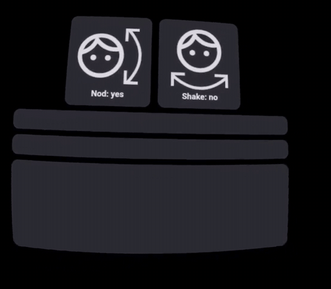
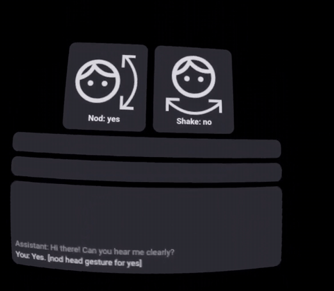
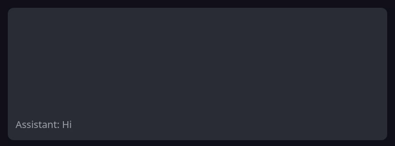

# Head nod and head shake in VR, as text in the language model's chat

A short series of tests on having a language model read a VR user's gestures, gaze, movement and intention through natural language descriptions. Inspired by SIAgent ([arXiv 2603.00522](https://arxiv.org/html/2603.00522)) and Explainable XR ([arXiv 2501.13778](https://arxiv.org/html/2501.13778)). The flow and the server already carry Illocutionary Lifecycles' nonconversational content socket, `SetNonconversationalContentSocket`, for things that neither the person nor the assistant said out loud, but that become text events for the prompt to use.

So far it has one test. In a VR headset, a head nod or a head shake answers a yes or no question, and the language model reads it as text. A line of text in the person's turn is one way a detected event can reach the conversation. The server also takes text that only goes to the incremental analyzers, and text that neither speaker said, which the model reads as context.

| Head nod | Head shake |
|---|---|
|  |  |



Built on [Illocutionary Lifecycles](https://github.com/LeoHuovinen/illocutionary-lifecycles) for the conversation and [Google XR Blocks](https://github.com/google/xrblocks) for the head gestures.

## Run

```bash
pip install "illocutionary-lifecycles[pipecat] @ git+https://github.com/LeoHuovinen/illocutionary-lifecycles@023b2a53846f"
python server.py
```

The keys go in `.env`, with the variable names from the `.env.example` in Illocutionary Lifecycles. Then open `http://localhost:7883/page/` in the headset's browser, with port 7883 forwarded to the headset. The server listens on 127.0.0.1 only, so a headset on Wi-Fi without the forward cannot reach it.

## Licence

MIT, see `../../LICENSE`. The two gesture pictures in `page/index.html` are Google's Material Symbols face_nod and face_shake, under the [Apache License 2.0](https://www.apache.org/licenses/LICENSE-2.0).
