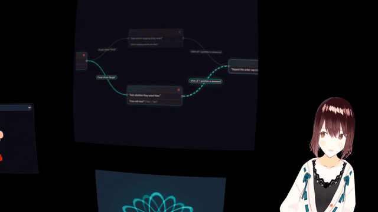

# Conversation running in VR using WebXR (multiple frontend options)



With `.env` set up as in `../README-VOICE.md`, run `python server.py` and open `http://127.0.0.1:7882/page/`.

The page shows a VRM model, with Pipecat's plasma visualizer and an animation from the Rive web runtime in its lower
corners, the karaoke of the spoken words and a listening or speaking label, and talks through IL's Pipecat voice mount.
The microphone stays open, and a pause in the user's speech ends their turn. In a WebXR session the VRM model stands
1.2 m in front of the viewer, with everything else on the page as flat panels around it. Read the repository's main
`README.md` and `../README-VOICE.md` first. Browsers allow the microphone and WebXR only on HTTPS or on `127.0.0.1`.

## The panels in VR

This section explains how everything else on the page appears in VR. A WebXR session shows only the 3D scene, never the
page's HTML, so during the session `page/xr_panels.js` copies each of them onto a flat panel in the VRM model's scene.
Whatever WebGL draws is copied on every WebXR frame at almost no cost. The karaoke and the label are
HTML, which is copied through modern-screenshot only after it changes and no more often than once every 150 ms, because
making a picture from HTML is slow and the frame waits for it.

Every place is set in the `PLACES` table at the top of `page/index.html`. The VRM model's entry is measured from where
the viewer stands when the WebXR session starts, so `z: -1.2` puts the VRM model 1.2 m in front of the viewer. Every
panel's entry is measured from the VRM model. In each entry `x` is metres to the right, `y` metres up from the floor and
`z` metres towards the viewer, `tilt` turns around the x axis and `turn` around the y axis, both in radians, and a panel's
`width` is in metres, its height following the shape of what it copies.

If you want a room around them, the WebXR Samples' [Cube Room](https://github.com/immersive-web/webxr-samples/tree/main/media/gltf/cube-room)
(CC BY 3.0) loads into the same scene with three.js's `GLTFLoader`, added to `vrm.scene`.

## Downloading models

The VRM models are downloaded separately, with the commands below. Run these commands in this folder. Amica's file names are one letter ahead of VRoid's, so each file is saved under its
VRoid name, and Amica's own `AvatarSample_A.vrm` is left out because its licence forbids redistribution.

```bash
mkdir -p page/vrm && cd page/vrm
curl -fL https://raw.githubusercontent.com/semperai/amica/master/public/vrm/AvatarSample_B.vrm -o AvatarSample_A.vrm
curl -fL https://raw.githubusercontent.com/semperai/amica/master/public/vrm/AvatarSample_C.vrm -o AvatarSample_B.vrm
curl -fL https://raw.githubusercontent.com/semperai/amica/master/public/vrm/AvatarSample_D.vrm -o AvatarSample_C.vrm
```

These are VRoid Project's sample avatars, about 15 MB each, free to use, change and redistribute without credit.
The animations for the Rive web runtime are downloaded into `../6-rive-pipecat/page/rive/` with the commands in
`../6-rive-pipecat/README.md`. Git ignores both folders.

## Files

Here is what each file does.

- `page/index.html` mounts every part, connects them with `ConnectConversation` and adds the panels.
- `page/pipecat_vrm.js` and `page/vrm_motion.js` show and move the VRM model, add the WebXR button and return its
  `scene` and `renderer` for the panels.
- `page/xr_panels.js` copies the page onto panels during a WebXR session, and runs the page's
  `requestAnimationFrame` callbacks on the WebXR frames, since a browser may pause `requestAnimationFrame` during the
  session.
- `flow.json` is the conversation, in which the user chooses pizza or burger. While the user speaks, it also picks a
  movement such as `nod` or `look_left` from their words, so saying "nod at me" makes the VRM model nod at once.
- `server.py` runs the Pipecat voice server described in `../README-VOICE.md` on port 7882, and also serves
  `../7-plasma-visualizer-pipecat/page/`, `../6-rive-pipecat/page/` and `../1-chatbot-visual-kiosk/page/` at
  `/page/plasma/`, `/page/rive/` and `/page/kiosk/`, so `page/index.html` imports their modules, pictures and licences
  where they are.

